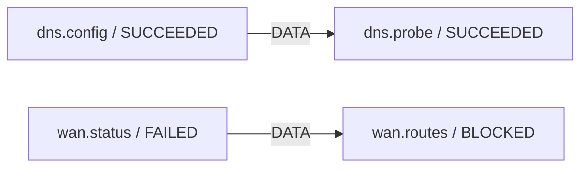
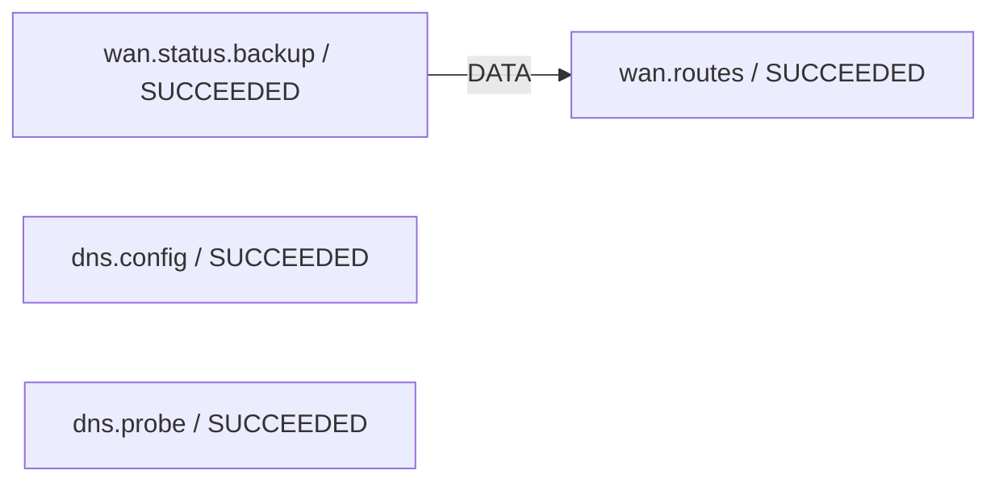

# Demo repair từ trace thực của replay

Timeout ở đây được điều khiển bằng fixture, không phải phép đo trên router thật.

## Plan revision 1

## Plan revision 2

Revision 2 thay WAN status bằng backup, giữ DNS đã xác minh; chi tiết binding/evidence/audit diff nằm trong `../runs/graph_v3_structural_final/repair_demo.json`.
